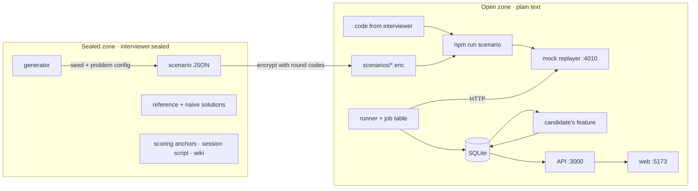

# TDD: Technical feature interview — one shareable repo

**Status:** Draft for review · rollout steps 2–3 built · **Author:** Ken Ojibe · **Date:** November 19, 2026 · **Reviewers:** [ ]

> This document is safe to share with candidates and colleagues. Everything that would give an interview away (which problems are planted, how strong they are, the reference answers, the scoring anchors) lives in the **sealed zone** (§5), encrypted inside this same repo.

---

## 1. Summary

A hiring loop for a mid-level engineer who turns a research paper into a working product feature. In a two-hour session, the candidate uses their own AI tools to read a paper, plan, and build one feature end to end in a small app that runs on their laptop. They are graded on research faithfulness, evaluation, system design, product judgment and how they use AI.

**Everything lives in one repo** (`collect-intel/technical-feature-interview`). You share that repo with candidates and colleagues alike. It has two zones:

- **Open zone (plain text):** the app, the runner, the mock services, the feature briefs, the tests, this TDD and the scoring rubric. This is what candidates work in.
- **Sealed zone (`interviewer.sealed`, encrypted):** the scenario generator, the catalogue of planted problems, reference and naive solutions, scoring anchors, the session script, the papers wiki and calibration data. Interviewers unlock it with a key; candidates can't.

**The interviewer reads out a code → the app decrypts that session's scenario → a local mock serves models, judges and embeddings that misbehave in planned ways → the candidate builds the feature on top of a working runner → the interviewer scores against the sealed anchors.**

Decisions for reviewers to weigh in on:

1. **One repo, two zones.** Shareability wins over physical separation. Secrecy comes from encryption with a strong key rather than from repo access (§5).
2. **Candidates know problems are planted; they don't know which ones.** This document and the rubric say openly that the scenarios contain realistic problems and that finding them scores. Hiding that wouldn't survive one candidate's write-up, and stating it is fairer.
3. **The mock server is a generic replayer.** It contains no trap logic. Planted problems exist only as data, generated in the sealed zone and shipped as encrypted scenarios (§4.3, §5).
4. **Extract from Weval Studio rather than strip it.** We lift Studio's pure modules (blueprint schema, matchers, seeded PRNG) and rebuild a small runner modelled on its plan → cell → finish. Studio itself is never booted (§11).
5. **Boots locally with no Docker, no API keys and no native builds:** Node with the built-in `node:sqlite` and `node:crypto`, Vite + React, and a local mock HTTP server (§4.1).
6. **Papers plug in as "paper packs."** The app, runner, sealing, rubric and session format don't depend on the paper. Each paper adds one pack: a brief, a generator module, planted problems, reference and naive solutions, a known-answer test and scoring anchors. Four packs exist (Judge Panel Trust, Model Monoculture, Convention Lab, Agent Fidelity); a round activates any of them, one per candidate by seed (§6.5).
7. **Candidate time is capped at about 3 hours**, and nothing a candidate builds is used in a product (§9).
8. **Each planted problem is tested.** Before each round, an interviewer runs `npm run check:interviewer`, which proves the reference solution catches each problem and a naive solution falls for it (§12). The key never leaves the password manager: no CI secret.

**Goals:**
- An interview that measures the real job: read a paper, check an AI-made plan against it, ship a feature honestly end to end.
- Reproducible sessions: the same code gives the same session on any laptop.
- Comparable scores across papers.
- One link to share.
- Maintenance that doesn't decay between hiring rounds.

**Non-goals:**
- Algorithm puzzles.
- Live model API calls.
- Real data of any kind.
- Proctoring. AI use is expected and observed, not policed.
- A senior variant (§14).

## 2. What the interview measures

This rubric is public. Candidates see it in advance. Per-paper anchors, meaning what each level looks like for a specific paper, are sealed.

| Dimension | Mid-level bar | Below bar | Senior signal |
|---|---|---|---|
| **Research faithfulness** | Implements the paper's method correctly; catches where the AI plan departs from the paper; records a decision wherever the paper is ambiguous | Builds whatever the plan says | Questions whether the method fits this data |
| **Evaluation first** | Gets the known-answer test passing *before* building the main logic | Tests at the end, or never | Adds a test of their own that exposes a problem in the data |
| **System design** | Sensible data model; computation off the request path; results versioned and re-runnable | Computes on every request; results can't be traced to their settings | Designs for the next feature as well as this one |
| **Product** | Works end to end for the user in the brief; empty, partial and error states handled | Happy path only | Pushes back on the brief with a better user outcome |
| **Honest output** | Intervals, exclusions and partial-run flags reach the screen | A bare number shown as fact | Explains the result's limits without being asked |
| **AI use** | Checks the output; can explain the AI-written code they kept | Accepts AI output wholesale | Uses the AI to explore alternatives quickly |

## 3. Architecture



The given parts already work at boot: runner, SQLite, mock and app shell, with one completed run in the database. **The candidate builds only the feature**, plus whatever changes to the schema, API and screen it needs. The system design happens inside that feature: where the computation runs, when it reruns, how it's versioned, and what the user sees meanwhile.

### Repository layout

```
technical-feature-interview/
├── README.md                 setup in one page; sandbox statement (§9)
├── AGENTS.md                 neutral: commands, layout, tests (§4.9)
├── docs/TDD.md               this document
├── docs/RUBRIC.md            §2 as a standalone page for candidates
├── briefs/                   one brief per paper pack (§6.5)
├── rounds/                   <round>.json: which packs are active, scenario ids
├── lib/                      lifted from Weval Studio, with NOTICE (§11)
├── mock/                     generic scenario replayer
├── server/                   runner, jobs, API
├── analysis/                 language-neutral analysis contract + Python stub
├── apps/web/                 Vite + React shell
├── scenarios/                *.enc, this round's sessions
├── tests/                    given tests (pass) + known-answer tests (fail until built)
├── scripts/                  doctor · scenario · reset · seal · unseal
├── interviewer.sealed        the sealed zone, one encrypted file
├── .githooks/pre-commit      refuses to commit plaintext from interviewer/
└── .github/workflows/        check.yml: boot, tests and leak checks on Mac, Linux and Windows
```

Once unsealed, the sealed zone unpacks to `interviewer/`, which is git-ignored:

```
interviewer/
├── CLAUDE.md          wiki rules (§6.4)
├── packs/<pack>/      one folder per paper (§6.5):
│   ├── problems.md        planted problems, each citing the paper section it comes from
│   ├── problems.yaml      their strengths, read by the generator
│   ├── generator.ts       seed → this pack's scenario data
│   ├── reference/         the correct solution
│   ├── naive/             a solution that follows a typical AI plan literally
│   └── anchors.md         scoring anchors with example answers
├── generator/         shared scenario writer; calls each active pack's generator.ts
├── session/           interviewer script, curveball cards, AI-delta questions
├── raw/               the papers (PDFs)
├── wiki/              one page per paper · index.md · log.md
└── calibration/       anonymised scores by paper and round
```

## 4. The candidate app (open zone)

### 4.1 Boot contract

| Requirement | How |
|---|---|
| One command | `npm install && npm run dev` starts the mock (:4010), API (:3000) and web (:5173) |
| No keys and no network after install | Every model, judge and embedding call goes to the local mock |
| No Docker and no native builds | Node's built-in `node:sqlite` and `node:crypto`; dependencies are pure JS |
| Mac, Linux and Windows | CI runs `doctor` and the tests on all three |
| Under 2 minutes from clone to running | Measured in CI and in every dry run |
| Node floor | Node 22.18 or newer: Node runs the TypeScript directly (type stripping, no build step) and `node:sqlite` needs no flag. Tested on 22.23. `doctor` enforces the floor |

`npm run doctor` checks the Node version, that the ports are free, that SQLite can write, and that a sample scenario round-trips. Candidates run it 48 hours ahead.

### 4.2 Distribution

Share the repo link. Each candidate works in **their own copy**: "Use this template" on GitHub, or a download of the round's release. They invite the interviewer to it, and their commits are the submission. Copies inherit `interviewer.sealed` as ciphertext, which is harmless without the key.

### 4.3 Mock replayer

A small HTTP server that **only replays the decrypted scenario**. Reading its source reveals nothing.

| Endpoint | Serves |
|---|---|
| `POST /v1/chat` | Model responses, keyed by (model, prompt id, temperature, system-prompt index, repeat) |
| `POST /v1/judge` | Judge verdicts, keyed by (judge, cell, criterion) |
| `POST /v1/embed` | Embedding vectors, keyed by a hash of the content |
| `POST /v1/agent` | Agent moves for the naming game, keyed by (simulation, step, agent) |
| `POST /v1/survey` | A participant agent's survey answer, keyed by (condition, participant, item) |

For each request key and attempt, the scenario can specify latency, a `429` with `Retry-After` (rate limits are a token bucket per provider), a `5xx`, a timeout or a malformed body. The attempt count lives in the mock's memory, so a restart resets it; that's what makes crash-and-resume testable. The same scenario and request order always give the same responses.

### 4.4 Runner

A simplified version of Studio's runner. Studio's own version is the reference in the sealed zone.

- **Plan:** freeze a manifest (blueprint hash, targets, judges, prompt versions, retry policy) and insert one `cells` row per (target × item × repeat) with a deterministic ID.
- **Cell:** generate, then grade with point functions and the judge panel. Retry transient failures with back-off. Record terminal failures as failures, never as zero.
- **Finish:** mark the run complete or partial.
- **Jobs:** a `jobs` table in SQLite with lease and heartbeat; no Redis. After a crash, expired leases are reclaimed, and completed cells are never called again.

### 4.5 Data model

```sql
runs        (id, blueprint_hash, manifest_json, manifest_hash, status, created_at, finished_at)
cells       (id, run_id, target_id, item_id, repeat, status, attempts, error_class)
responses   (cell_id, text, tokens_in, tokens_out)
verdicts    (cell_id, criterion_id, judge_id, verdict, score, raw)
embeddings  (content_hash, model, vector BLOB)
sim_runs    (id, params_json, seed, status, progress)          -- Convention Lab
sim_events  (sim_run_id, step, agent_a, agent_b, offered_json, choice_a, choice_b, success)
studies     (id, title, conditions_json)                       -- Agent Fidelity
study_participants (study_id, participant_id, groups_json)
study_items (study_id, item_id, text, kind, options_json)
study_answers (study_id, participant_id, item_id, wave, answer)   -- wave 1 and wave 2, two weeks apart
call_log    (request_id, run_id, kind, model, prompt_version, attempt, status, latency_ms, cost_usd, at)
jobs        (id, kind, payload_json, status, lease_until, attempts, last_error)
analyses    (id, run_id, method, method_version, params_json, interpretations_json,
             input_hash, status /* partial|final|stale */, result_json, created_at)
```

`call_log` is given and complete: request ID, model, prompt version, latency and cost for every call, the per-call fields hiring guides expect of production AI work. `analyses` is the feature's output contract.

### 4.6 The analysis contract (language-neutral)

The feature's computation reads a run and writes one row to `analyses`. Candidates may write it in **TypeScript** (`server/analysis/`) or **Python** (`analysis/`, standard library `sqlite3` only, run with `python -m analysis <method> <run_id>`). Each row carries:

- `method` and `method_version`.
- `params_json`: the method's settings.
- `interpretations_json`: the choice made wherever the paper is ambiguous, recorded in the data and not only in the write-up.
- `input_hash`: a hash of the rows used, so a changed run marks the analysis `stale`.
- `status`: `partial` if the run wasn't complete.

### 4.7 API and web shell

Given endpoints: `GET /runs`, `GET /runs/:id`, `GET /runs/:id/cells`, `POST /runs`, `GET /jobs/:id`. Each brief's endpoint is the candidate's to design; the API shape is part of the design review.

The web shell provides routing, a table component, a chart library and one empty route per brief: `/runs/:id/panel`, `/runs/:id/diversity` and `/lab`.

### 4.8 Tests

- **Given tests (passing):** runner, mock, call log, schema.
- **Known-answer tests (failing until implemented),** one file per brief:
  - **Panel:** the paper's simulation (4 judges with accuracies 0.6–0.9, K = 2, 10,000 questions) gives weighted vote ≥ Inverse Surprising Popularity > majority vote.
  - **Diversity:** identical vectors score 100; random high-dimensional vectors score about 0.
  - **Lab:** with 2 names and no bias, final conventions split roughly 50/50 across seeds.
- `npm test` runs everything.

### 4.9 `AGENTS.md`

Commands, layout, the analysis contract, how to run one test. It points to the briefs and the rubric and says nothing about specific problems. The candidate's AI assistant should work as it would in a real repo, because how they use it is part of what we observe.

### 4.10 Feature briefs

Each brief uses the Linear house format: an HMW line, problem, how it affects users, acceptance criteria, tests, and before and after. **The first acceptance criterion is always the known-answer test.** The sandbox statement (§9) heads every brief.

| Brief | HMW | Feature | Paper |
|---|---|---|---|
| **Judge Panel Trust** | …help blueprint authors trust a verdict when their judges disagree? | A "Panel" tab: aggregated verdict per check with a method switch (majority vote, Inverse Surprising Popularity, Optimal Weight), judge weights, flags for problem judges, and how many verdicts differ from majority vote | Beyond Majority Voting ([arXiv 2510.01499](https://arxiv.org/abs/2510.01499), ICML 2026) |
| **Model Monoculture** | …show authors when models converge on the same answer? | A "Diversity" view: collective similarity per model and condition, with intervals and a drill-down to the most typical responses | Doshi & Hauser, *Science Advances* 2024 ([PMC11244532](https://pmc.ncbi.nlm.nih.gov/articles/PMC11244532)) |
| **Convention Lab** | …let researchers watch how norms form among agents? | A small app: configure a population, run the simulation as a job with progress and cancel, then show the convergence curve and a critical-mass sweep across seeds | Flint Ashery, Aiello & Baronchelli, *Science Advances* 2025 ([arXiv 2410.08948](https://arxiv.org/abs/2410.08948)) |
| **Agent Fidelity** | …show researchers how faithfully each participant's AI agent answers as that person would? | An "Agents" page: the paper's normalized accuracy per agent condition, with an interval, broken down by group, plus the gap between the best- and worst-served groups | Park et al. 2024, *Generative Agent Simulations of 1,000 People* ([arXiv 2411.10109v1](https://arxiv.org/abs/2411.10109v1); later versions are a different paper) |

## 5. Sealing

### 5.1 What is sealed and what isn't

| Sealed (encrypted) | Open (by design) |
|---|---|
| Which problems are planted, how strong they are, and where | That problems are planted (Decision 2) |
| The generator, reference and naive solutions | The app, runner, mock replayer and tests |
| Scoring anchors, session script, curveball cards | The rubric (§2) and the briefs |
| The papers wiki and calibration data | The papers themselves (public) |
| Each session's scenario, until its code is read out | The scenario's data *during* the session. Inspecting raw data is good practice and scores |

### 5.2 Two kinds of encrypted file

| File | Key | Who unlocks it | When |
|---|---|---|---|
| `interviewer.sealed` | The **interviewer key**: 32 random bytes (base64url) from `npm run keygen`, kept in the team password manager only | Interviewers and maintainers | `npm run unseal`, once per machine |
| `scenarios/<id>.enc` | A **session code**: 6 words, derived from the interviewer key with HKDF over (round, scenario) | The candidate, at the start of the session | `npm run scenario -- <code>` |

Session codes are **derived, not stored**. `npm run codes -- <round>` regenerates the code sheet from the interviewer key, so there's no list of codes to lose. A session code opens only its own scenario; it can't open the sealed zone or other scenarios.

### 5.3 Mechanics

- **Cipher:** AES-256-GCM with keys from scrypt (interviewer key) or HKDF (session codes). Built on `node:crypto`, with no dependencies.
- **`npm run seal`** packs `interviewer/` into one bundle and encrypts it. It skips rewriting if the content hasn't changed, using an HMAC of the plaintext under the key, so unchanged content doesn't create noisy commits.
- **`npm run unseal`** decrypts to `interviewer/`, which is git-ignored.
- **Accepted cost:** the sealed zone's history is opaque in `git diff`. Maintainers review changes after unsealing, and `interviewer/wiki/log.md` records what changed and why.

### 5.4 Guarding against plaintext leaks

1. `interviewer/` and `.scenario/` are git-ignored.
2. A pre-commit hook (enabled by `npm install` via `core.hooksPath`) refuses any staged file containing the **canary line** that `seal` writes at the top of every sealed file.
3. CI fails if any tracked file contains the canary. The canary is public and harmless; it exists to be detected.
4. `npm run check:interviewer` (§12) scans every tracked file for each problem's distinctive phrases.

### 5.5 Threat model

- **Protects against:** candidates reading the sealed zone or scenarios early, and copies of the repo spreading.
- **Doesn't protect against:** a leaked interviewer key, or a candidate who gets a session code from someone else.
- **If the interviewer key leaks,** every past version of the sealed zone is readable, because the ciphertext is in git history. Treat it as burning the current problems: rotate the key, regenerate scenarios with new seeds, and replace papers whose problems are now known.
- **If a session code leaks,** only that round is affected. Retire it and cut a new round.

## 6. The interviewer zone (sealed)

The planted problems and how to score them are documented in each pack's `interviewer/packs/<pack>/problems.md`, not here.

### 6.1 Generator

- **Deterministic:** `mulberry32` seeded from `hashSeed(round, paper, seed)`. These are the same functions as Studio's `cip-math/fns/prng`, and they're lifted into `lib/` (§11).
- **Strength comes from each pack's `problems.yaml`**, so difficulty can be tuned without editing code.
- **Every planted problem cites the paper section** whose gap it exploits. Problems are found in the papers, not invented.

### 6.2 Reference and naive solutions

- **Reference:** one per brief. This is what "correct" means for scoring. Where Studio already implements the maths, it reuses that code: clustered intervals, agreement statistics, the PRNG.
- **Naive:** one per brief, following a typical AI plan literally. Its job is to prove that each planted problem actually catches someone (§12).

### 6.3 Scoring anchors

For each paper and each rubric dimension, the anchors describe concrete behaviours at each level. Studio's `MATH.md` conventions (null never zero, determinism, tie-break policy) supply the edge-case checklist.

### 6.4 Wiki (the LLM wiki pattern)

The sealed zone's knowledge base follows the LLM wiki pattern (Karpathy, April 2026):

- **`raw/`:** papers, never edited.
- **`wiki/`:** Claude writes one page per paper (method, gaps found, problems built on each gap, dry-run notes), plus `index.md` and `log.md`, and people review them.
- **`CLAUDE.md`** defines the structure and three operations:
  - **Ingest:** add a paper, write its page, write or update the pack's `problems.md`, update the index, append to the log.
  - **Query:** answer interviewer questions from the wiki first, citing pages.
  - **Lint:** run before each round. Every entry in `problems.yaml` must cite a wiki page; open questions must be resolved or still flagged; no orphaned pages.

### 6.5 Paper packs

Everything except the paper-specific content is generic, so a new paper means a new pack, not a new interview.

**What a pack contains**

| Zone | Files | Purpose |
|---|---|---|
| Open | `briefs/<pack>.md` | The feature brief in the Linear house format |
| Open | `tests/known-answer/<pack>.test.ts` | The known-answer test, failing until implemented |
| Open | `apps/web` route stub | An empty page for the feature |
| Open, only if needed | a schema migration and a mock endpoint kind | For data the existing shapes don't cover (below) |
| Sealed | `interviewer/packs/<pack>/` | Problems, strengths, generator, reference, naive, anchors |
| Sealed | `interviewer/wiki/<pack>.md` | The ingested paper (§6.4) |

**Data shapes the mock already serves:** model responses, judge verdicts, embeddings, agent moves, and survey studies (people's answers at two points in time, loaded into `study_*` tables, plus agents' answers from `/v1/survey`). Most evaluation and collective-intelligence papers fit one of these. A paper that needs something else adds **one new shape once**, and later packs reuse it. Examples: survey answer distributions, an approval matrix, agent task trials with human completion times.

**A paper fits if it passes this checklist.** The wiki ingest records the result.

1. **Implementable in about 40 minutes with AI help:** a metric, algorithm, estimator or simulation. Not a training run, not GPU work, not a purely conceptual argument.
2. **Runs on synthetic data** the mock can serve, now or after adding one shape.
3. **Has a known-answer test:** a synthetic case whose correct result is known in advance.
4. **Has at least two real gaps or ambiguities** to plant problems on, cited to sections of the paper.
5. **Becomes a feature for a named user** in a Weval- or CIP-style product.
6. **Is peer-reviewed or otherwise stable,** so the method doesn't change between rounds.
7. **Calibrates:** after dry runs, its score distribution sits close to the other active packs'.

**Candidates already assessed against the checklist**

| Fits as-is | Fits after adding one data shape | Reading only (fails item 1) |
|---|---|---|
| Miller, Adding Error Bars to Evals (2024) | Santurkar et al., Whose Opinions (2023): survey distributions (the survey-study shape now covers part of this) | All intelligence is collective intelligence |
| Bowyer et al., Don't Use the CLT (2025) | METR time horizon (2025): agent trials with human completion times | Collective intelligence in biology |
| Dawid & Skene (1979) / AutoEval (2024) | Generative social choice (2023/2025): approval matrix | Minority influence and divergent thinking |
| Ruan et al., Observational Scaling Laws (2024) | τ-bench pass^k (2024): repeated agent trials | Habermas Machine; Community Notes RLCF (both need training) |

**Adding a pack.** Ingest the paper into the wiki, run the checklist, write the pack, then make `npm run check:interviewer` pass. That means the reference solution catches every problem and the naive one falls for each (§12). Finally dry-run with 1–2 internal people. Budget **2–3 days per pack**, plus a day if it needs a new data shape.

**Rotation.** `rounds/<round>.json` lists the active packs and their scenario IDs. A round can mix new and existing packs. Scores compare across packs because the rubric's dimensions are shared and only the anchors differ by pack; calibration (§8) is tracked per pack.

## 7. Session protocol

| Stage | Time | What happens |
|---|---|---|
| Before | ≤ 1 h, candidate's own time | A human call first. Then the repo link, the papers and `doctor`, 48 h ahead |
| Read the brief and synthesize the paper | 10 min | NotebookLM or similar; the candidate names one thing the paper leaves unspecified |
| Plan | 15 min | Claude or similar writes a plan; the candidate shows where it departs from the paper. Elicit is optional, for finding a paper that challenges the method |
| Design review | 15 min | Data model, where the computation runs, API shape |
| Build | 65 min | One curveball partway through |
| Demo and defence | 15 min | Demo, a deviations note, and **the AI delta**: one AI-written function they kept, and why it's correct |

The candidate shares their screen throughout. The interviewer scores live and finalizes within 24 hours.

## 8. Scoring

- Each of the six rubric dimensions (§2) is scored 1–4, using the sealed per-paper anchors (§6.3).
- **No single total score.** The hiring decision reads the profile.
- **Calibration:** after every 10 candidates, compare score distributions by paper. If one paper is noticeably harder, retune its `problems.yaml` for the next round. **Never adjust candidates' scores after the fact.**

## 9. Candidate experience and fairness

- **Time cap:** about 3 hours in total. Anything longer gets paid.
- **Sandbox statement** at the top of the README and every brief: this is an interview exercise on synthetic data, and nothing built is used in a CIP product. Hiring guides document take-homes being used as unpaid product ideation, and our features resemble real Studio features, so we say so up front.
- **A human conversation comes before anything is sent.**
- **The rubric is published** in advance, and so is the fact that problems are planted.
- **AI tools are expected.** NotebookLM, Elicit and Claude are suggested, not required. We grade each stage's output, not familiarity with a tool.
- **Accessibility:** extra time on request; setup checked ahead with `doctor`.
- **Candidate copies:** the candidate owns theirs. We ask them to keep it private, and we delete our clones within 90 days.

## 10. Security and confidentiality

- **The repo can be shared openly.** Its secrecy rests on encryption (§5), not on who can see it. It could even be public, though private is the default.
- **Keep it separate from `product-platform` and `data-platform`.** Their visibility and release processes are governed by other rules.
- **Rotate each round:** a new round ID changes every session code. Rotate the interviewer key after any suspected leak (§5.5) and whenever an interviewer leaves.

## 11. Reuse from Weval Studio and licensing

| Lifted into `lib/` (open zone) | From `product-platform` | Notes |
|---|---|---|
| Blueprint schema | `packages/shared/src/features/cip-blueprints/contract.ts` | Depends only on `zod` |
| Matchers and point functions | `…/cip-blueprints/matchers.ts`, `pointFunctions/` | Keep `pointFunctions/NOTICE.md` (adapted from weval) |
| Seeded PRNG | `…/cip-math/fns/prng/{mulberry32,hashSeed}.ts` | No dependencies; the generator uses it too |

| Used as a reference (sealed zone) | From |
|---|---|
| Runner, resume, manifest | `worker/src/features/cip-blueprints/runner.ts`, `…/cip-blueprints/{plan,manifest}.ts` |
| Intervals and agreement | `…/cip-math/fns/{interval,agreement}/`, `docs/MATH.md` |

Langfuse is MIT-licensed; keep its licence notice alongside anything lifted, and keep weval's notice on the point functions. `judge.ts` depends on Studio's system-prompts compiler, so use a fixed judge prompt instead of lifting it.

## 12. Testing

**`check.yml`** runs on every push, in our repo and in candidates' copies:
- `doctor` and the given tests on Mac, Linux and Windows.
- Clone-to-boot time measured.
- Known-answer tests confirmed to *fail* on a fresh checkout.
- Canary scan: no plaintext from the sealed zone is tracked (§5.4).

**`npm run check:interviewer`** runs on an interviewer's machine before each round, after `npm run unseal` (no CI secret, so the key stays in the password manager):
1. Check that the generator is deterministic: the same round, paper and seed give byte-identical scenarios.
2. **The reference solutions pass:** the known-answer tests run against `interviewer/reference/` (`ANALYSIS_COMMANDS=interviewer/reference/commands.json npm run test:known-answer`), and every planted problem is caught.
3. **Every planted problem is real:** for each one, the naive solution must *fail* its check. A problem the naive approach doesn't fall for tests nothing, and CI fails.
4. **The scenarios match the ciphertext:** decrypting each `scenarios/*.enc` with its derived code gives exactly what the generator produces for that round and seed.
5. **No leaks:** every tracked file is scanned for each problem's distinctive phrases.
6. **Wiki lint** (§6.4).

## 13. Rollout

1. **You** create `collect-intel/technical-feature-interview` (private, template enabled) and attach it to the working session.
2. **App skeleton** *(done)*: boot, `doctor`, mock replayer, runner, schema, web shell, `check.yml` on three operating systems.
3. **Sealing** *(done)*: `seal`, `unseal`, `scenario` and `codes`; the pre-commit hook; the canary scan.
4. **Sealed zone** *(partly done: reference solutions, `check:interviewer`, problem drafts)*: generators, scenarios and naive solutions for the four packs.
5. **Wiki ingest** of the first three papers, resolving every open question by reading the full texts.
6. **Briefs** in the Linear house format; `docs/RUBRIC.md`; the session script and curveball cards.
7. **Dry runs:** 1–2 internal people per paper. Record the results in `calibration/` and retune.
8. **First round:** cut the round and send the link to the first candidates.

## 14. Open questions

- **Stack:** TypeScript (this document's default) if the hire works mainly in Studio, or Python if mainly on the data platform. Python is in about 72% of AI-engineering postings. The language-neutral analysis contract (§4.6) covers the gap for now.
- **Pay:** a flat fee for the session, or only past 3 hours?
- **Tool accounts:** provide Elicit and NotebookLM access, or allow any equivalent tool (current default)?
- **Paper details to confirm:** two planted problems depend on gaps that the papers' appendices might resolve. They stay provisional until the wiki ingest (rollout step 5).
- **Interviewers:** who is trained, and how many shadow sessions each before running one alone?
- **Senior variant:** Community Notes bridging or generative social choice, with an ambiguous brief rather than a scoped one.
- **Future rotation:** [AGORA](https://arxiv.org/pdf/2611.05556) and [Nine Judges, Two Effective Votes](https://arxiv.org/html/2605.29800v1), once they've been through peer review.

## 15. Alternatives considered

| Alternative | Verdict |
|---|---|
| Two repos (open starter + private kit) | No: two links to manage and keep in sync. Encryption gives the same secrecy in one shareable repo |
| `git-crypt` or `age` for the sealed zone | No: a separate install on every interviewer machine. `node:crypto` is already there |
| Encrypt each sealed file separately | No: file names would reveal the problems (a name like `naive/<problem>.ts` says what it tests). One bundle reveals nothing |
| Hide that problems are planted | No: it wouldn't survive one candidate's write-up, and saying so is fairer (Decision 2) |
| Strip Weval Studio as the base | No: Postgres, ClickHouse, Redis, a worker and roughly 300k lines of CIP features can't boot in a session, and the runner answer already exists in that repo |
| Trap logic inside the mock server | No: readable source would reveal the problems. Replayer plus sealed generator keeps them as data |
| Hosted scenario service | No: breaks "offline after install" and adds an outage risk during interviews |
| Live model APIs | No: cost, fairness (candidates' keys and rate limits) and non-reproducible sessions |
| Docker Compose | No: fails on locked-down laptops and adds minutes |
| `better-sqlite3` | No: native build failures on Windows and fresh Macs; `node:sqlite` covers our needs |
| Python throughout | Not by default, because we lift TypeScript from Studio. Python is allowed for the analysis stage; revisit under §14 |
| Take-home only | No: watching how candidates use NotebookLM, Elicit and Claude is the point. The take-home part is limited to about 1 hour of pre-reading |
| One paper for every candidate | No: it leaks between candidates. Three rotating papers on one rubric keep scores comparable |
